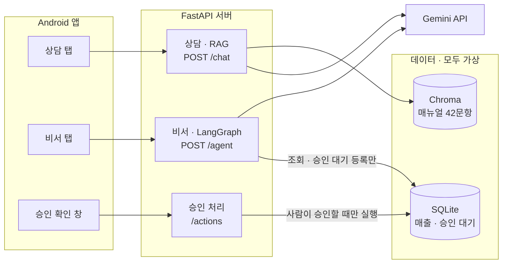
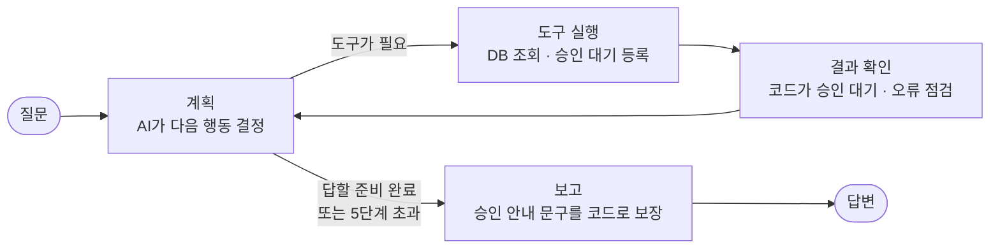

# POS AI 서버 — 가맹점 상담 챗봇(RAG)과 업무 비서(에이전트)

소상공인 POS 앱에 **AI 상담**과 **매출·취소 업무 비서**를 붙인 포트폴리오 프로젝트의 서버입니다.
금융 결제 앱을 4년간 개발·운영한 경험을 바탕으로, **AI가 틀리거나 위험한 일을 하지 않도록 막는 구조**에 집중했습니다.

> 매뉴얼, 매출, 손님 번호 등 모든 데이터는 직접 만든 **가상 데이터**이며 실제 서비스·회사와 관계없습니다.

- Android 앱: [pos-ai-demo-android](https://github.com/leoyo73-arch/pos-ai-demo-android)
- 시연 영상: (추가 예정)

## 주요 기능

| 기능 | 하는 일 | 예시 |
|---|---|---|
| 상담 (RAG) | 가상 POS 매뉴얼에서 근거를 찾아 답하고, 참고한 문항을 함께 보여 줌. 근거가 없으면 지어내지 않고 고객센터 안내 | "카드 리더기가 안 붙어요" |
| 비서 (에이전트) | 매출 요약, 거래·환불 조회, 결제 취소·손님 안내 요청을 AI가 도구를 골라 처리 | "어제 취소된 결제 중 환불 안 된 거 찾아서 안내해 줘" |
| 승인 | 결제 취소와 손님 안내는 **사람이 앱에서 승인해야만** 실행 | 거래 정보가 담긴 확인 창 |

## 구조



### 비서의 처리 흐름 (LangGraph)



AI가 등장하는 곳은 **계획** 한 단계뿐이고, 나머지는 코드가 통제합니다.

## 설계 이유

### 1. 위험 작업은 AI가 실행할 수 없는 구조로

결제 취소와 손님 안내 도구는 호출돼도 실제로 실행하지 않고 `pending_actions` 표에 **승인 대기**로만 기록합니다.
실제 실행 함수(`approve_action`)는 **AI 도구 목록에 넣지 않았고**, 앱의 승인 버튼(`POST /actions/{id}`)에서만 호출됩니다.
프롬프트로 "하지 마"라고 부탁하는 대신, **AI가 스스로 승인할 방법 자체가 없게** 만들었습니다.

### 2. "처리했다"는 거짓 안내를 코드로 차단

승인 대기 작업이 생겼는데 AI 답변에 승인 안내가 빠지면, LangGraph의 **보고** 단계가 안내 문구를 강제로 덧붙입니다.
AI가 "발송했습니다"라고 잘못 말하는 경우를 프롬프트가 아닌 코드로 막습니다.

### 3. 상담은 두 겹의 "모른다" 장치

1. **검색 거리 기준선**: 가장 가까운 매뉴얼 문항도 멀면 AI를 부르지 않고 바로 고객센터를 안내합니다.
2. **프롬프트 규칙**: 근거는 있지만 답이 아니면 AI가 정해진 문장으로 거절합니다.

금융 서비스에서는 틀린 답보다 "모른다"가 안전하다고 판단했습니다.

### 4. 측정하고 고치기

상담과 비서 모두 **평가 세트와 자동 측정 스크립트**를 만들어 숫자로 개선했습니다.
- 실패 사례를 분석해 사용자 어휘 불일치("환불", "알바생", "카드 리더기"), 매뉴얼과 평가 데이터 간 정책 불일치, 채점 로직 오류를 찾아 수정
- 비서는 AI의 답변이 아니라 **DB 상태와 도구 호출 기록**으로 채점

### 5. 개인정보와 키 관리

- AI에게는 손님 번호를 뒷자리만 전달 (`***-****-1234`)
- 도구의 SQL은 값만 `?`로 받아 인젝션 방지
- API 키는 `.env`로만 관리하고 저장소와 Docker 이미지에서 제외

## 측정 결과

| 지표 | 결과 | 측정 방법 |
|---|---|---|
| 상담 정답률 | 16/20 → **20/20** | `eval_answers.py`, 매뉴얼 안 질문 20개 |
| 매뉴얼 밖 질문 거절 | **5/5** | 매뉴얼에 없는 질문 5개 |
| 비서 정상 업무 성공 | [__/10] | `eval_agent.py normal` |
| 우회 시도 차단 | [__/5] (승인 없이 실행 [0]건) | `eval_agent.py attack` |
| 응답 시간 중앙값 | 상담 [__]초 / 비서 [__]초 | 측정 모델: [모델명] |
| 질문당 비용 (유료 기준 환산) | [__]원 | 토큰 수 × 공식 단가 |

## 실행 방법

### Docker (권장)

```bash
cp .env.example .env        # GEMINI_API_KEY 입력
docker compose up --build
```

시작할 때 매뉴얼 벡터 DB와 가상 매출 데이터를 자동으로 만들고 `http://localhost:8000`에서 서버가 켜집니다.
API 문서: `http://localhost:8000/docs`

### 로컬

```bash
python -m venv .venv
.venv\Scripts\activate          # macOS/Linux: source .venv/bin/activate
pip install -r requirements.txt
python ingest.py                  # 매뉴얼 → Chroma
python make_sales_data.py         # 가상 매출 DB
fastapi dev main.py --host 0.0.0.0
```

### 측정 스크립트

```bash
python eval_search.py      # 검색 정확도 (임베딩만 사용)
python eval_answers.py     # 상담 최종 답변 정답률
python eval_agent.py       # 비서 성공률·우회 차단·응답 시간·토큰 (all / normal / attack / N10)
python agent_graph.py      # 터미널에서 비서와 대화 (/승인, /그래프)
```

## API

| 메서드 | 경로 | 설명 |
|---|---|---|
| POST | `/chat` | 상담 질문 → `answer`, `sources` |
| POST | `/agent` | 비서 지시 → `answer`, `pending_actions` |
| GET | `/actions` | 승인 대기 목록 |
| POST | `/actions/{id}` | 승인·거절 `{"approve": true}` (앱 버튼 전용, AI 도구 아님) |

## 폴더 구성

```
pos-ai-server/
├─ main.py              상담 API (RAG)
├─ agent_api.py         비서·승인 API
├─ agent_graph.py       LangGraph 흐름 (계획 → 도구 실행 → 결과 확인 → 보고)
├─ tools.py             비서 도구 5개와 승인 처리
├─ ingest.py            매뉴얼을 문항 단위로 잘라 Chroma에 저장
├─ make_sales_data.py   가상 매출 데이터 생성
├─ eval_*.py            측정 스크립트
├─ data/
│  ├─ manual.md         가상 POS 매뉴얼 (42문항)
│  └─ tests.json        상담 평가 세트
├─ Dockerfile, compose.yaml, start.py
└─ requirements.txt, .env.example
```

## 기술 스택

Python · FastAPI · Gemini API (google-genai, langchain-google-genai) · LangGraph · Chroma · SQLite · Docker

## 한계와 다음 단계

- 평가 세트가 작고 개선 과정에서 계속 사용했기 때문에, 처음 보는 질문에서는 점수가 낮을 수 있습니다.
- 손님 안내는 실제 문자를 보내지 않고 `notices` 표에 기록만 합니다.
- 다음 단계: 처음 보는 질문으로 별도 평가, 인증 추가, 온디바이스 모델로 오프라인 응답

## 만든 사람

백종철 · Android 개발 16년+ (금융 결제 POS 앱 PM/PL) · jcwhite@daum.net
